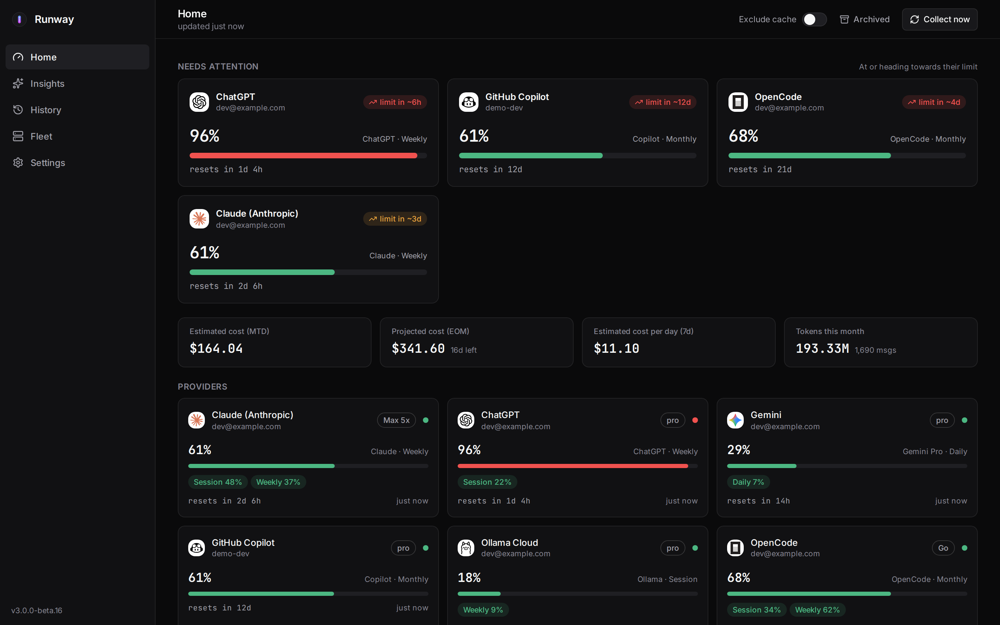
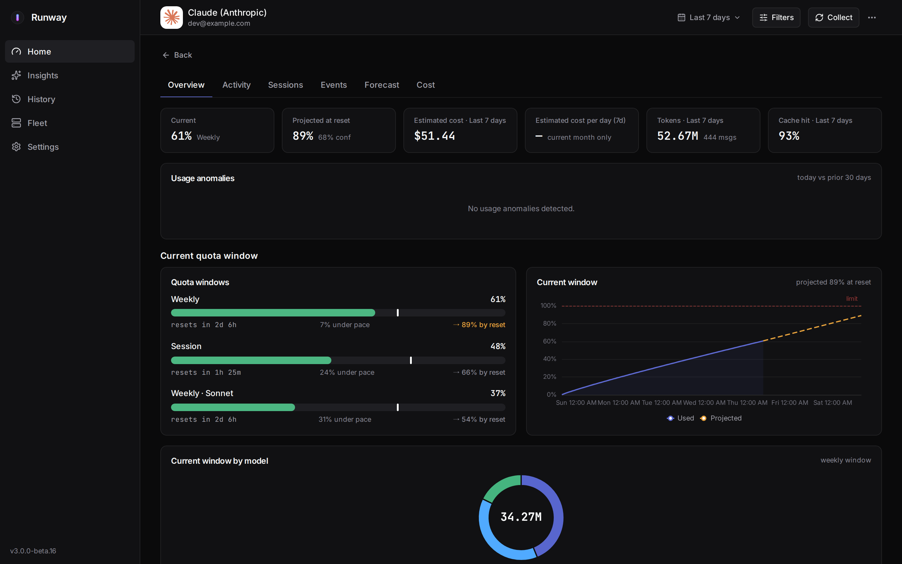
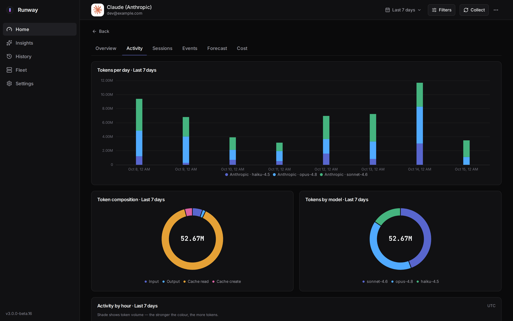
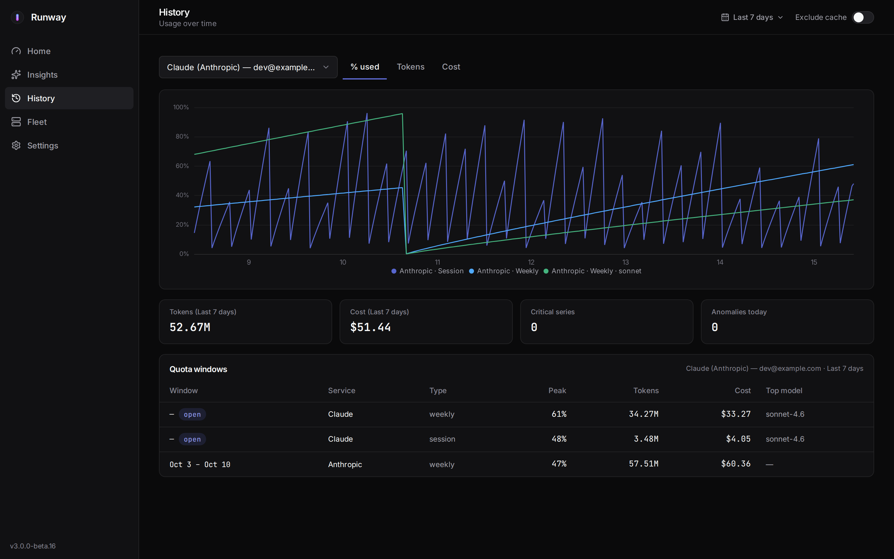
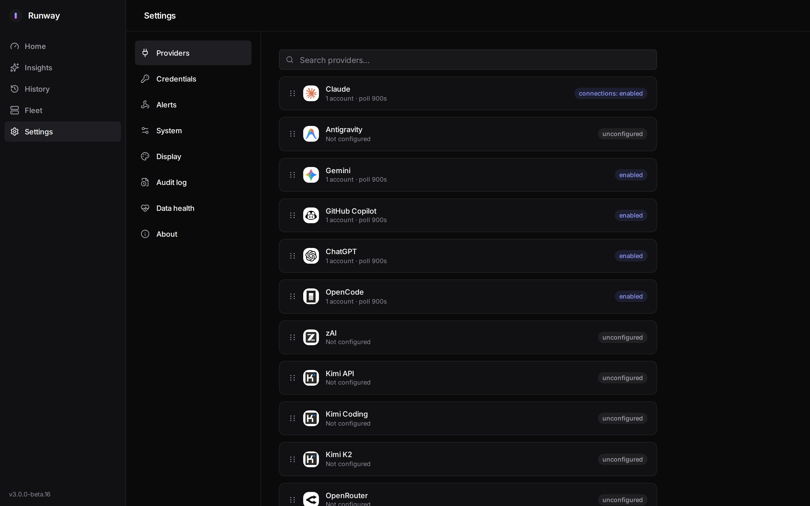
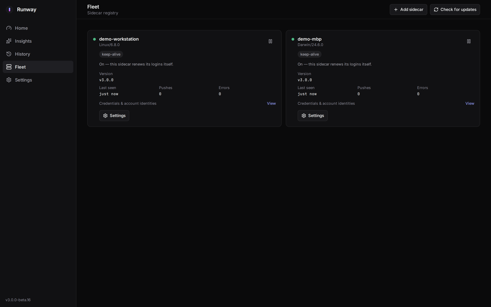
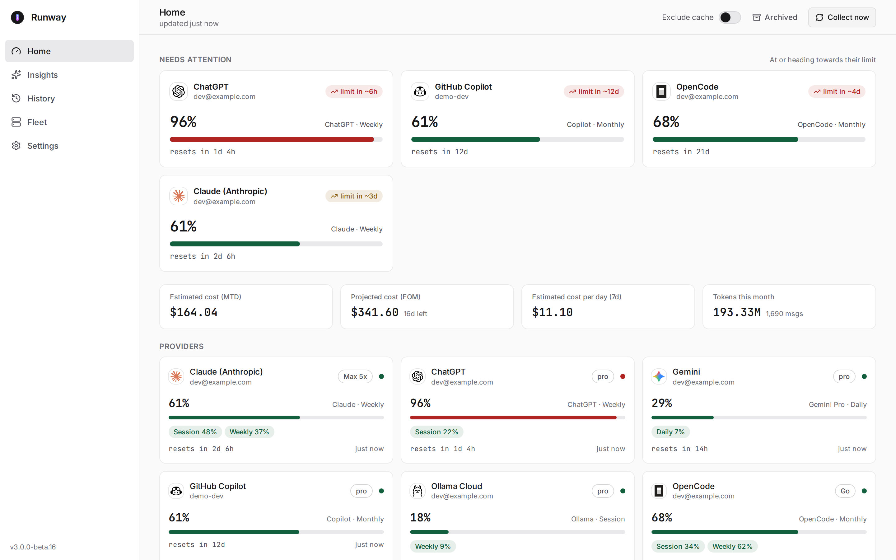

<p align="center">
  
</p>

# Runway — AI Subscription Limits Dashboard

**Runway** is a local-first dashboard that shows how much of your AI subscriptions and API credits you have left, when each limit resets, and where your usage went. It covers Claude, ChatGPT/Codex, Gemini, GitHub Copilot, Kimi, xAI and more in one place, keeps a persistent history, and projects when you will run out.

Upgrading from 2.x? See the [v3 migration notes](docs/migration-v3.md).



<p align="center"><sub>Dark theme shown. Light theme follows your OS preference or Settings → Display.</sub></p>

## Screenshots

<table>
<tr>
<td width="50%"><a href="docs/screenshots/provider-dark-desktop.png"></a></td>
<td width="50%"><a href="docs/screenshots/provider-activity-dark-desktop.png"></a></td>
</tr>
<tr>
<td align="center"><sub><b>Provider</b> — usage windows with pace and projection, the current window's forecast, per-model split <a href="docs/screenshots/provider-light-desktop.png">(light)</a></sub></td>
<td align="center"><sub><b>Activity</b> — daily tokens, composition and models for any time range <a href="docs/screenshots/provider-activity-light-desktop.png">(light)</a></sub></td>
</tr>
<tr>
<td width="50%"><a href="docs/screenshots/history-dark-desktop.png"></a></td>
<td width="50%"><a href="docs/screenshots/settings-dark-desktop.png"></a></td>
</tr>
<tr>
<td align="center"><sub><b>History</b> — % used, tokens and cost across windows, with a forecast overlay <a href="docs/screenshots/history-light-desktop.png">(light)</a></sub></td>
<td align="center"><sub><b>Settings</b> — providers, credentials, alerts, display, audit log, data health <a href="docs/screenshots/settings-light-desktop.png">(light)</a></sub></td>
</tr>
<tr>
<td width="50%"><a href="docs/screenshots/fleet-dark-desktop.png"></a></td>
<td width="50%"><a href="docs/screenshots/dashboard-light-desktop.png"></a></td>
</tr>
<tr>
<td align="center"><sub><b>Fleet</b> — your sidecars, their versions, keep-alive and unmapped credentials <a href="docs/screenshots/fleet-light-desktop.png">(light)</a></sub></td>
<td align="center"><sub><b>Light theme</b> — the dashboard following your OS preference</sub></td>
</tr>
</table>

## Features

**Limits at a glance**
- **16 providers** — Claude, Claude Console, ChatGPT/Codex, Gemini, GitHub Copilot, OpenRouter, DeepSeek, MiniMax, Ollama, OpenCode, zAI, Kimi (API, Coding, K2), xAI and Antigravity. See the [provider list](docs/collectors/README.md).
- **Home dashboard** with an at-risk rail for limits about to run out, provider cards you can drag into your own order, and archived and merged accounts kept out of the way.
- **Reset timers, pace and forecast** — each window shows how fast you are burning it, and a Theil-Sen projection says when it runs out.
- **Fallback per provider** — each collector tries its strategies in order (for example the official API, then a web session) and shows an error card instead of breaking the page when all fail.

**Usage history**
- **Per-message history** — every assistant message is stored as an immutable event; windows, rollups and cost are derived from that log, so numbers can be repaired and recomputed.
- **Provider pages** with Overview, Activity, Sessions, Events, Forecast and Cost tabs, plus a raw upstream capture for debugging.
- **One time-range picker** — last 24 hours, 7/14/30/90 days, this or last month, or a custom span — shared by History, Insights and the provider tabs, and deep-linkable.
- **Global Insights** — lifetime totals, cache-hit ratio, busiest day and hour, and rankings of top models, projects, tools, sessions and hosts.
- **Projects and sessions** — events carry the working directory, project, git branch, tool names and session names from Claude Code, Codex, Antigravity, opencode and MiniMax Code. Claude Code cloud-runner usage is collected too.

**Many machines, many logins**
- **Sidecars** run on each workstation to read local logins and per-message events, then push them to the server. Pair a new one from Fleet with a one-time link.
- **Fleet** lists every sidecar with version, OS and activity, pause and resume, per-sidecar settings and updates, and a banner for credentials found but not yet mapped to an account.
- **Credentials** (Settings → Credentials) show where each account's login comes from — which machine, environment variable, file, keychain or cookie — its expiry, and refresh or remove actions.
- **Keep-alive** (opt-in) renews xAI, Claude Code, Codex and Antigravity logins from the sidecar so they do not lapse while the CLI sits idle. It is not supported by the tray app. Set a fleet-wide default and override it per login.

**Operations**
- **Alerts** to Discord or Slack when a limit crosses a threshold or a login expires or is rejected.
- **Data health** scans the database for known inconsistencies and offers a preview-then-apply fix.
- **Audit log** of admin changes, and **About** with the exact build the server runs.
- **Secure by default** — local trust on localhost, an admin key with an HttpOnly session cookie elsewhere, SSO via forward-auth, encrypted sensitive metadata, HMAC-signed sidecar ingestion.
- **Installable PWA**, light and dark themes, compact and two-column layouts.

## Quick start

You need **Python 3.12+** and **Node.js 22.22.2+** with **npm 11.11+**. Node 23.x and 24.0–24.14 are rejected by npm; the supported range is `^22.22.2 || ^24.15.0 || >=26.0.0`.

```bash
git clone https://github.com/s3ntin3l8/runway-ai-usage-tracker && cd runway-ai-usage-tracker
make install          # venv, dependencies and git hooks
cp .env.example .env  # add the API keys you have
make dev-all          # server + frontend + local sidecar (Ctrl-C stops all)
```

Open `http://localhost:5173`. `make run-all` serves the built app from the server at `http://localhost:8765`. `make help` lists every target.

**Just looking?** `make demo` starts a throwaway instance with synthetic data on `127.0.0.1:3965`. It reads nothing from your `.env` or home directory and deletes itself on Ctrl-C. See [docs/demo.md](docs/demo.md).

### Docker

Use the shipped [`docker-compose.yml`](docker-compose.yml) or the [Traefik stack](docs/deployment.md#docker-behind-traefik). Before the first start set `DB_ENCRYPTION_KEY`, `CORS_ORIGINS`, and either `ADMIN_API_KEY` or a forward-auth proxy with `TRUSTED_PROXY_IPS`; `TLS_TERMINATED=1` only when a proxy really terminates TLS. The [deployment guide](docs/deployment.md) has the steps.

> [!IMPORTANT]
> A container cannot see your desktop keychains or browser cookies. Run a [sidecar](docs/sidecar.md) on every workstation you want to monitor, or provide credentials through environment variables or Settings.

### Sidecar installers

Every [release](https://github.com/s3ntin3l8/runway-ai-usage-tracker/releases) ships a macOS menu-bar app (`.dmg`), a Windows tray installer (`-setup.exe`), a Linux tray app and a headless Linux CLI binary, with `SHA256SUMS.txt` and Sigstore signatures. The Fleet page links the right one for your OS. The desktop apps are not signed with an Apple Developer ID or Windows certificate, so the OS asks once before the first launch: on macOS right-click → **Open**, on Windows **More info** → **Run anyway**. Install, update and verification details are in [docs/sidecar.md](docs/sidecar.md).

## Need to know

- **Server plus sidecars.** The server collects from APIs, aggregates and serves the dashboard. Everything that touches a workstation — browser cookies, keychains, CLI logins, IDE and log files — runs in a sidecar. See [architecture](docs/architecture.md).
- **Security defaults.** Runway binds to `127.0.0.1` and trusts localhost. For any other bind set `ADMIN_API_KEY` or put it behind a forward-auth proxy, and never expose it to the internet without a reverse proxy and HTTPS. See [SECURITY](docs/SECURITY.md) and [forward-auth / SSO](docs/forward-auth.md).
- **Configuration.** [`.env.example`](.env.example) documents every variable and its default; [deployment](docs/deployment.md) explains the ones that decide whether a deployment works.
- **Stuck?** [Troubleshooting](docs/troubleshooting.md) is organised by symptom.

## Documentation

[docs/README.md](docs/README.md) indexes everything: deployment, sidecar, API reference, per-provider collector docs, security, and contributor guides. To contribute, start with [CONTRIBUTING.md](CONTRIBUTING.md).

## License

Copyright (C) 2026 Björn Hansen

This program is free software: you can redistribute it and/or modify it under
the terms of the GNU Affero General Public License as published by the Free
Software Foundation, either version 3 of the License, or (at your option) any
later version (SPDX: `AGPL-3.0-or-later`). See [LICENSE](LICENSE).
